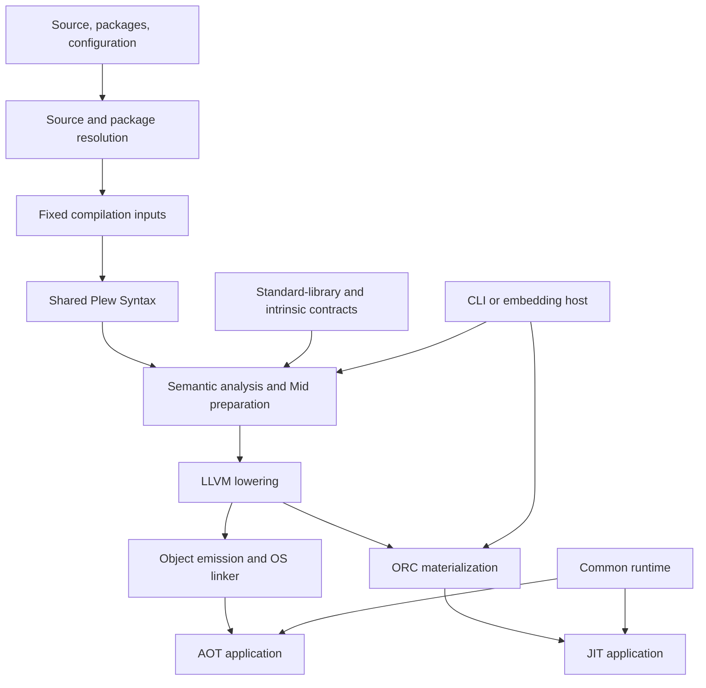

# Architecture and Design Principles

**Status:** First draft for review. The boundaries below describe the intended architecture based on adopted decisions. They do not certify that the current implementation satisfies every boundary. Unresolved details are identified explicitly.

## 1. Purpose, Scope, and Constraints

Plew's compiler translates the language's explicit meaning into an executable representation. Its design must let a contributor predict where a change belongs, which facts it changes, and which downstream consumers must be updated. The [purpose of this reference](README.md) is the criterion for whether this overview is useful.

The [language specification](https://github.com/plew-lang/spec/blob/main/SPEC.md) defines observable behavior and source-level acceptance rules. Value semantics, explicit shared identity, unique ownership, and the event-loop execution model are language contracts. ARC and CoW realize those contracts without making their physical costs part of ordinary source reasoning. Compiler transformations may remove costs but must preserve meaning.

The current architectural choices are a self-hosted compiler, shared `@Plew/Syntax` infrastructure, a place-based non-SSA Mid, and an LLVM backend serving ahead-of-time compilation and ORC execution. These are adopted implementation choices, not claims that the language requires those particular mechanisms. Changing them requires an explicit design decision rather than a local fallback.

This chapter defines major responsibilities and handoffs. It does not define every IR instruction, cache key, or runtime layout. Nor does it promise persistent incremental compilation, a stable binary embedding interface, additional backends, or compiler-owned Hot Restart orchestration.

## 2. System Context



These arrows describe dependencies and handoffs, not source-module imports or ownership of all objects in a process. The specification governs the entire system; it is not a runtime input.

| Responsibility | Authority | Boundary |
|---|---|---|
| Package and source selection | Resolver and source loader | Admit a fixed set of source/dependency/configuration inputs; later lazy requests must not mix in edited files |
| Syntax | Shared syntax package | Produce syntax and source provenance without choosing overloads or types |
| Source meaning | Semantic checking | Resolve the source program under an explicit environment and publish its decisions |
| Path-sensitive validity | Mandatory analyses | Validate the chosen meaning, including ownership/access obligations; do not reinterpret source syntax |
| Representation | Instantiation, Mid, ABI, LLVM in their respective domains | Make only the decisions delegated to that boundary |
| Runtime operations | Common runtime | Execute compiler-generated operations according to a shared protocol |
| Diagnostic representation and rendering | Diagnostics infrastructure | Preserve domain-produced causes and provenance; formatting does not decide source acceptance |
| Scheduling and process integration | Driver and external host | Request work, report diagnostics, manage execution; do not provide independent semantic rules |

Library code is normally checked through the same machinery as application code. Compiler-known operations require an explicit compiler/library/runtime contract; a familiar name or compiler-specific special case is not sufficient justification for bypassing checking.

## 3. Compilation Model and Handoffs

Compilation is dependency-driven, even when a command requests whole-target checking. It is not necessarily one eager traversal through a sequence of mutable tables. The following graph shows the execution-preparation path.


Declaration-time validation also uses mandatory static analyses without requiring machine code. Generic declarations are checked under their bounds; a concrete instance is not required to establish that the declaration is valid. The diagram shows execution preparation, not a requirement that every command instantiate and emit every body.

The following names are conceptual artifacts, not requirements to introduce correspondingly named implementation types.

| Result | Decision owner | Successful publication guarantees | Legitimate remaining work | Consumers |
|---|---|---|---|---|
| Fixed inputs and syntax | Loader: input identity; parser: syntactic structure | Consistent source version, package/configuration identity, node provenance | Resolve declarations and meaning | Lookup and semantic checking |
| Checked source body | Semantic checker: source member/call selection, types, conversions, flow meaning | Required source facts are complete under the declared environment; abstract obligations are explicit and justified | Substitute a concrete environment; discharge instance-dependent obligations | Generic instantiation and declaration analyses |
| Concrete body facts | Instantiation: substitutions and first concrete witness selection where deferred legitimately | Execution-relevant types, call relationships, and evidence are complete for the instance | Construct CFG and perform mandatory path-sensitive analyses | Mid construction and preparation |
| Prepared Mid | Mid preparation: valid operations, ownership/access analysis, required elaboration | Required static analyses succeed; remaining dynamic checks have an enforcement plan | Choose physical representation and emit operations | ABI and LLVM lowering |
| Physical calling/layout decisions | ABI lowering: target representation and calling contracts | Physical signatures and layouts preserve semantic identity and ownership contracts | Emit and optimize LLVM; resolve native symbols | LLVM backend and native integration |
| LLVM module and native publication | Backend: LLVM translation; object/ORC boundary: executable publication | Owned module resources and valid emitted artifacts; code becomes callable only after required preparation and publication succeed | Link/load and execute according to runtime protocols | Linker, ORC, execution host, common runtime |

Mid preparation must know the semantic ownership and access contract of each call. Target-specific ABI lowering chooses how that contract is represented physically; it does not establish that semantic contract for the first time.

Publication is scoped. A checked body does not certify a whole target; a locally prepared body does not by itself certify interprocedural effects, global initialization, or callable publication. Each consumer must receive the level of preparation it needs. A type named `Prepared` or a read-only wrapper is not proof of those guarantees by itself.

Pending, failed, and not-applicable results are distinct from successful results. For example, a generic trait operation can be valid under a declared bound while its concrete witness remains instance-dependent. That is a successful abstract result, not an executable concrete result. If concrete witness resolution fails, no concrete success is published; a subsequent request must not recover permission to execute from the existence of a partially filled row. Cache validity and failure reuse must be defined by the state/computation contract rather than inferred from nonzero IDs.

## 4. Decision Ownership

### One Authority, Multiple Analyses

Each semantic decision has one authority. Repeated traversals, validation, and memoized computation are allowed; independent selectors that can disagree about the same source operation are not. Lookup gathers candidates. Checking selects the applicable source meaning. Downstream code consumes that meaning rather than searching the source again to obtain a convenient answer.

Construction, successful publication, and consumption have different permissions. A consumer must not complete a missing required fact by rerunning overload resolution or inventing a default type. An optional query must distinguish a fact that does not apply from a required fact that is missing.

Authoritative results retain the scope, body origin, substitutions, and evidence that give them meaning. A derived cache may be discarded or recomputed only under a validity contract that preserves those authorities. Type identity is not physical layout equality, and matching types alone do not prove that evidence came from the correct call site or environment.

### Source Checking and Concrete Instantiation

Source checking fixes a generic body's selected operation and obligations under its declared bounds. For a trait method, this can identify the trait requirement and its signature without identifying a concrete implementation body.

Instantiation substitutes a concrete environment and may select the concrete witness for that requirement for the first time. It must preserve the source-selected requirement and associated relationships; it must not reconsider unrelated same-named members or allow a concrete type's extra capabilities to justify an invalid generic declaration.

The detailed division of common obligation-resolution operations, evidence representation, and publication APIs belongs in the types, checking, and generics chapters. This overview does not adopt a new universal solver or request framework.

### Flow and Mandatory Validation

Semantic checking determines source-level value formation, divergence, and escape targets. Mid lowering preserves those facts as control flow. Ownership/access analyses transfer and join their states over that flow; they do not independently inspect whether a source block ends with `give` to infer its meaning.

Fixing source meaning does not imply that all validity checks have passed. Mandatory path-sensitive analyses may reject that meaning—for example, because a value is used after a move. CFG optimization may discover additional unreachable edges, but it must not redefine whether a source expression supplies a value or change source-level reachability diagnostics.

### Synthesis and Optimization

A synthesis that introduces semantic choices uses the common selection, signature, and evidence contracts. A mechanical adapter built from checked facts may be generated directly in the appropriate IR; it need not be translated back to source and checked again. Both must satisfy applicable ownership and ABI obligations.

This applies to closures, default-argument expansion, provided methods, implicit protocol calls, global initializers, and foreign-call adapters. None is an exemption that allows a second interpretation of the same source decision.

Mandatory transformations establish executable correctness. Optional transformations improve cost while preserving meaning. An optimization cannot become the only mechanism that makes an otherwise invalid intermediate state safe.

## 5. Modes and Execution Boundaries

The [command contract](https://github.com/plew-lang/spec/blob/main/spec/04-execution/15-modules.md) defines the requested checking scope. Commands use common semantic rules and preparation infrastructure.

| Mode | Requested work | Result and limitation |
|---|---|---|
| `check` | Static checking of the selected target and dependencies, including unused and generic bodies | Static validity; no application execution or machine-code generation; not a guarantee that all backend implementation limits are absent |
| `build` | Whole-target static checking plus executable preparation and LLVM compilation | Optimized binary; checked but unused code need not be emitted |
| `run` | Demanded bodies and their checking/generation dependencies | ORC execution; success does not certify unrequested bodies |
| Generated host program | Required host-side program and its validation dependencies | Generated source admitted through normal source/module rules; not an alternate language checker |

Lazy checking is body-level, not execution-path-only checking. A demanded body is checked before execution, including branches that the current invocation does not take. Dependencies may require broader analysis; an unknown effect is not treated as harmless just to keep a request small.

One execution uses one source/dependency/configuration version. Scheduling compilation lazily does not delay top-level initialization or alter argument order, ARC/CoW semantics, or destruction rules.

During in-process compilation, application execution and event handling stop. A failed demand does not start the failed body; diagnostics are reported and standalone `run` exits unsuccessfully. Already performed I/O is not rolled back. External framework hosts own their windows, watch/restart policies, and any future reusable execution lifecycle. This chapter does not promise those host APIs are implemented.

AOT and JIT share the execution runtime, including memory management, access checks, Promise behavior, and event processing. Differences in code availability are handled at execution entry/materialization boundaries, not by duplicating runtime semantics.

For async code, semantic checking determines permitted suspension and effects; ownership analysis determines lifetime obligations; Mid transformations construct the state machine; runtime protocols operate its frames, Promises, and continuations. The runtime does not own the compiler transformation. Target concurrency requirements beyond the event-loop baseline must be tracked explicitly rather than inferred to be implemented.

## 6. A Representative Path and Change Impact

Consider this source-level example:

```plew
fn choose(flag: Bool) -> I64 {
    val result: I64 = if flag {
        give 1I64
    } else {
        return 2I64
    }
    return result
}
```

The example illustrates specified source meaning, not an execution test performed for this document.

1. Parsing records the conditional, bindings, `give`, and `return` with source locations.
2. Checking uses the available `I64` context, establishes the value-producing branch and function-returning branch, and records the binding type and escape targets. The return's value is not another result of the `if` expression.
3. No generic witness is needed here. The executable preparation path consumes the same checked binding and flow facts; it does not infer them from the AST again.
4. Mid construction represents the branch and its exits. Required cleanup follows ownership and scope on each edge. Only the normal value-producing path initializes `result`.
5. ABI/LLVM lowering preserves the typed operations and exits while choosing physical representation. Native publication makes the prepared body callable, and runtime operations obey the same contracts in AOT and JIT.

Variations reveal additional boundaries without requiring separate full traces:

- If a branch calls a generic trait operation, checking records its source-selected requirement; instantiation supplies the concrete witness. A failed obligation blocks concrete publication, not just eventual LLVM emission.
- If the value is produced inside a closure or initializes a global, origin and scope change, but the saved binding/type/call facts remain authoritative. A global path must not substitute a separate statement-type fallback for the checked binding.
- If a new expression form is added, syntax describes it, checking owns its value/flow meaning, and Mid owns its operational lowering. ABI and runtime need changes only if the new meaning requires new physical or execution contracts.

| Proposed change | First responsibility to consult | Affected handoffs and verification |
|---|---|---|
| Change a callable or trait requirement | Lookup, types/evidence, and checking: candidate formation is distinct from final selection | Checked signatures/obligations → instances → calls; verify abstract declarations, concrete witnesses, and final execution rather than reader-only success |
| Change an access-check runtime operation | Ownership/access defines required placement and lifetime; runtime defines the operation's execution protocol | Enforcement plan → ABI/LLVM operation → runtime; verify matching begin/end lifetimes and AOT/JIT behavior |
| Add an expression wrapper | Syntax and body checking | Preserve available context and selected meaning through Mid; use direct-versus-wrapped cases under the same context, including escapes |

These are responsibility maps, not implementation task lists. Migration issues must identify actual legacy paths to remove and verification evidence. Completing a producer without connecting its final consumers is not completion of that migration.

## 7. Reading Paths and Implementation Mapping

[Compiler State, Identity, and Computation](compiler-state.md) defines the shared session and publication contracts. Other detailed chapters are planned, not yet published; their names below indicate responsibility destinations rather than existing links.

| Task | Primary reading path |
|---|---|
| Add or change source semantics | Sources/Syntax → Name Lookup → Types and Evidence → Body Checking → affected Mid contracts |
| Change generic behavior | Types and Evidence → Body Checking → Generics and Body Instantiation → Mid/ABI consumers |
| Change ownership or performance | Compiler State → Ownership and Access → Passes → relevant ABI/Runtime boundary |
| Change lazy execution | Compiler State → Driver and Demand-Driven Execution → LLVM/Runtime; preserve common checking contracts |
| Diagnose an acceptance mismatch | Domain checking contracts → Diagnostics → Verification; compare the same requested body/environment |

Confirmed source entry points at the revision below include [CheckedProgram](../../src/CheckedProgram.pw) for session/checking and execution-preparation boundaries, [PreparedProgram](../../src/PreparedProgram.pw) for LLVM-independent program preparation, and [CompilerSessions](../../src/CompilerSessions.pw) for the callback registry's session lifetime. These are navigation aids, not evidence that all intended invariants are structurally enforced. Module names need not mirror chapters.

### Implementation Evidence and Open Work

- **Inspected revision:** `6fe09bc7c0e75260b3f773643921478b5020b94f`.
- **Inspection scope:** introductory contracts and selected entries in the three linked files, plus the existing architecture/type-checking review inputs. This was a documentation exercise, not an implementation audit or runtime validation.
- **Unverified scope:** complete decision-authority closure, all alternate consumers, cache validity, synthesized paths, backend/runtime conformance, and performance. No tests or self-compilation were run for this chapter.
- **Open design detail:** domain-specific artifact types, common obligation-resolution APIs, and exact publication/state contracts belong in their owning chapters. This overview must not be used to claim they are settled or implemented.
- **Related implementation gaps:** local `tk` issue management has been adopted but is not initialized. The existing type-checking remediation record in the meta repository remains the migration input until issues are established; do not interpret the absence of issue links as a clean audit.

Correctness must be supported at each handoff by structural APIs, verifiers, and tests appropriate to the contract. A successful source reader test does not prove final Mid/LLVM consumption. Bootstrap fixed-point equality does not prove language correctness. Detailed assurance strategy belongs in the verification chapter; changing baselines and operational commands remain outside this reference.
